 

### `> cat featured.txt`

|      | project                                                                | what it does                                                                       |
| ---- | ---------------------------------------------------------------------- | ---------------------------------------------------------------------------------- |
| `01` | **[StudyMesh](https://studymesh.app)**                                 | Builds study groups from schedules, preferences and strengths.                     |
| `02` | **[Algorithm Trainer](https://algorithm-trainer.com)**                 | Master data structures and algorithms through guided exercises and visualizations. |
| `03` | **[EcoCoin](https://github.com/ChefAharoni/EcoCoin)**                  | Smart contracts that turn recycled bottles into on-chain rewards.                  |
| `04` | **[Miko](https://github.com/ChefAharoni/CPP-FinalProject-EmbeddedML)** | Compiles trained neural nets into tiny C++ for a Raspberry Pi Pico (team project). |
| `05` | **[MeetSync](https://meet-sync.app)**                                  | Share a link, mark availability, find the overlap. No accounts.                    |
| `06` | **[Haaretz Archive](https://haaretzarchive.com)**                      | Searchable archive of historical Haaretz weekend magazines.                        |

### `> cat wins.txt`

| place    | competition                                                                                          | when |
| -------- | ---------------------------------------------------------------------------------------------------- | ---- |
| `1st`    | **[DistrictCon Badge Challenge](https://www.linkedin.com/posts/amit-aharoni_districtcon-cybersecurity-badgechallenge-ugcPost-7421432421948162049-O3bh/)**, Washington D.C. (solo) | 2026 |
| `3rd`    | **[CSAW Embedded Security Challenge](https://csaw.io/competition/embedded-security-challenge)**, NYU | 2025 |
| `winner` | **[Cloudflare Hackathon @ AI Summit NY](https://github.com/ChefAharoni/StepCharge)** (best app)      | 2023 |
| `1st`    | **[BMCC STEM Innovation Challenge](https://github.com/ChefAharoni/CUNYCoin)** (team lead)            | 2023 |

CTFs with **CUCyber** (Columbia): best finishes `#37/789` GlacierCTF 2024, `#39/287` KalmarCTF 2025, `#40/432` PwnSec 2025, `#59/885` EHAX 2026, `#75/931` LA CTF 2025. [Full list on CTFtime ↗](https://ctftime.org/team/62539) · Organizer, HackCUNY 2024.

### `> cat toolkit.txt`

`Python` `Java` `C / C++` `Bash` `SQL` `Assembly` `Swift` `Solidity` `React` `Node.js` `Docker` `AWS` `Cloudflare` `Linux` `Git / GitHub Actions` `Wireshark` `Penetration Testing` `Reverse Engineering` `Cryptography` `CTFs`

<code>// trust nothing. verify everything. ship anyway.</code>

